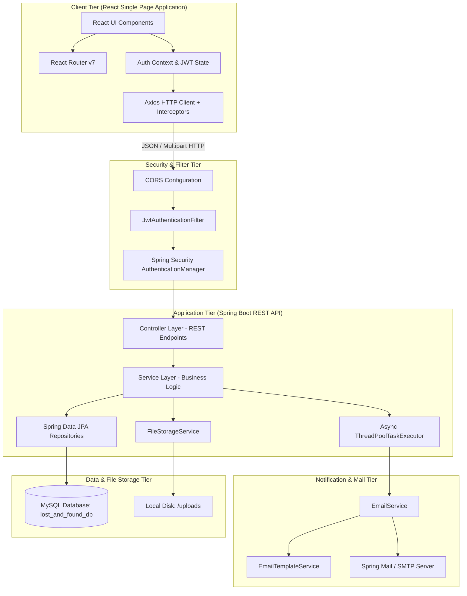
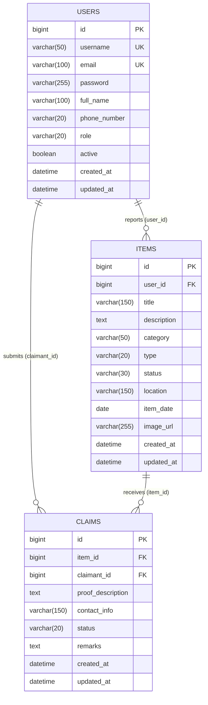
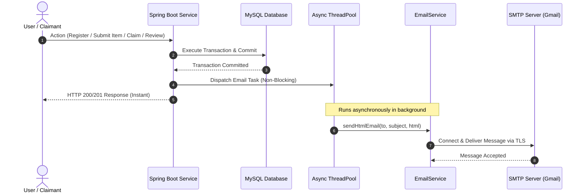

# 🔍 Lost & Found Portal — Full-Stack Web Application

> **A standalone, modern, responsive full-stack web application designed for campus and community environments where users can report lost or found items, search listings, submit verified ownership claims, track item recovery, and receive automatic transactional email notifications.**

[](https://www.oracle.com/java/)
[](https://spring.io/projects/spring-boot)
[](https://spring.io/projects/spring-security)
[](https://spring.io/guides/gs/sending-email/)
[](https://www.mysql.com/)
[](https://react.dev/)
[](https://maven.apache.org/)
[](https://junit.org/junit5/)
[](LICENSE)

---

## 📑 Table of Contents

1. [Project Overview & Key Objectives](#1-project-overview--key-objectives)
2. [High-Level System Architecture](#2-high-level-system-architecture)
3. [Technology Stack & Rationale](#3-technology-stack--rationale)
4. [Database Design & Schema (ERD)](#4-database-design--schema-erd)
5. [Security & Authentication Architecture](#5-security--authentication-architecture)
6. [Core Features & Business Logic](#6-core-features--business-logic)
7. [Email Notification System](#7-email-notification-system)
8. [Comprehensive REST API Reference](#8-comprehensive-rest-api-reference)
9. [Frontend Architecture & Component Structure](#9-frontend-architecture--component-structure)
10. [Project Folder & File Structure](#10-project-folder--file-structure)
11. [Prerequisites & Environment Setup](#11-prerequisites--environment-setup)
12. [Step-by-Step Execution Guide](#12-step-by-step-execution-guide)
13. [Postman API Testing Guide](#13-postman-api-testing-guide)
14. [Default Test Accounts & Environment Configuration](#14-default-test-accounts--environment-configuration)
15. [Automated Test Suite (27 Tests)](#15-automated-test-suite-27-tests)
16. [Troubleshooting & Common Questions](#16-troubleshooting--common-questions)
17. [Future Roadmap](#17-future-roadmap)

---

## 1. Project Overview & Key Objectives

In university campuses, corporate workplaces, transit hubs, and residential communities, personal belongings (wallets, laptops, ID cards, keys, accessories) are frequently lost or found. Traditional lost-and-found processes depend on fragmented physical bulletin boards, scattered social media messages, or front-desk boxes, leading to low recovery rates, lack of privacy, and fraudulent claims.

The **Lost & Found Portal** provides a centralized, secure digital solution with:
- **Instant Reporting:** Quickly post lost or found items with photos, tags, categories, location, and dates.
- **Dynamic Search & Filtering:** Filter by keyword, category, status, and item type with sub-second responsive UI updates.
- **Proof-Backed Ownership Claims:** A structured verification flow where claimants submit distinguishing proof of ownership (serial numbers, marks, secret contents) before items are returned.
- **Asynchronous Email Notifications:** Automatic, branded HTML email notifications for registrations, listings, incoming claims, approvals, rejections, item recovery, and potential match alerts.
- **Privacy & Concurrency Hardening:** Safe public DTOs that prevent leaking reporter contact details, pessimistic write database locking to prevent concurrent claim approvals, and safe user deactivation.
- **Dual Dashboards:** A user dashboard for personal listings and incoming claim reviews, plus an administrative console for platform metrics, moderation, and user management.
- **Zero Mock Data:** Built on persistent MySQL storage with stateless JWT authentication.

---

## 2. High-Level System Architecture

The application adopts a decoupled, multi-tier client-server architecture:



### Architectural Highlights
- **Decoupled Architecture:** The React frontend runs on Vite and communicates with the Spring Boot backend strictly via REST JSON APIs and multipart uploads.
- **Stateless Authentication:** Spring Security operates in stateless mode (`SessionCreationPolicy.STATELESS`). Authentication state is encapsulated within signed JWT tokens transmitted in the HTTP `Authorization: Bearer <token>` header.
- **Non-Blocking Notifications:** All emails are processed asynchronously (`@Async("emailTaskExecutor")`) after database transactions commit. SMTP latencies or network interruptions never block HTTP requests or rollback data operations.
- **Layered Backend Design:** Follows enterprise Spring patterns:
  - `Controller`: Request mapping, DTO validation, HTTP response encapsulation.
  - `Service`: Transaction boundaries (`@Transactional`), state machine validation, business logic.
  - `Repository`: Spring Data JPA declarative interfaces with custom JPQL queries and pessimistic write locking.
- **Standardized Response Envelope:** All endpoints return a uniform `ApiResponse<T>` wrapper with `success`, `message`, `data`, and `timestamp`.

---

## 3. Technology Stack & Rationale

| Layer / Concern | Technology | Version | Rationale & Responsibility |
| :--- | :--- | :--- | :--- |
| **Backend Framework** | Java / Spring Boot | Java 17+, Boot 3.x / 4.x | Enterprise-grade framework providing robust REST controllers, dependency injection, and JPA integration. |
| **Security** | Spring Security | 6.x | Stateless role-based access control (`ROLE_USER`, `ROLE_ADMIN`), request filtering, and CORS support. |
| **Token Authentication** | JJWT (io.jsonwebtoken) | 0.12.6 | Industry-standard HMAC-SHA256 token creation, claims extraction, and cryptographic verification. |
| **Email & Notifications** | Spring Boot Mail | Jakarta Mail | Asynchronous transactional HTML email delivery supporting Gmail SMTP and local dev simulation. |
| **Async Execution** | Spring Task Execution | Spring Framework | Dedicated `ThreadPoolTaskExecutor` preventing email delivery from blocking user HTTP requests. |
| **Persistence / ORM** | Spring Data JPA / Hibernate | 7.x | Eliminates boilerplate SQL, automates DDL synchronization, and enables JPQL filtering with pessimistic locking. |
| **Database** | MySQL Server | 8.0+ | ACID-compliant relational database engine with indexed foreign keys and unique constraints. |
| **Frontend Framework** | React.js | 18+ / 19+ | Component-driven UI development with reactive state and declarative rendering. |
| **Frontend Build Tool** | Vite | 5+ / 6+ | Sub-second Hot Module Replacement (HMR) and optimized rollup production bundles. |
| **Routing** | React Router DOM | v7 | Client-side routing with nested routes and declarative `<ProtectedRoute>` guards. |
| **HTTP Client** | Axios | 1.7+ | Promise-based client with interceptors for Bearer token injection and 401 response handling. |
| **Icons & Styling** | Lucide React + Custom CSS | Latest | Lightweight SVG icon set with a custom responsive CSS design system (zero heavy CSS dependencies). |
| **Build & Tooling** | Apache Maven | 3.9+ (via `mvnw`) | Self-contained build automation with included Maven Wrapper (`mvnw.cmd` / `mvnw`). |
| **Automated Testing** | JUnit 5 & Mockito | 5.x / 17.x | 27 automated unit and integration tests covering security, workflow, validation, and email dispatch. |
| **API Testing** | Postman | Latest | End-to-end API testing collection included in project root. |

---

## 4. Database Design & Schema (ERD)

The database `lost_and_found_db` consists of 3 relational tables with foreign keys and unique constraints:



### Table Definitions & Constraints

#### 1. `users` Table
- `id`: `BIGINT AUTO_INCREMENT PRIMARY KEY`
- `username`: `VARCHAR(50) NOT NULL UNIQUE`
- `email`: `VARCHAR(100) NOT NULL UNIQUE`
- `password`: `VARCHAR(255) NOT NULL` (BCrypt hash)
- `full_name`: `VARCHAR(100) NOT NULL`
- `phone_number`: `VARCHAR(20) NULL`
- `role`: `VARCHAR(20) NOT NULL DEFAULT 'ROLE_USER'`
- `active`: `BOOLEAN NOT NULL DEFAULT TRUE` (Safe account deactivation flag)
- `created_at`: `DATETIME NOT NULL`
- `updated_at`: `DATETIME NULL`

#### 2. `items` Table
- `id`: `BIGINT AUTO_INCREMENT PRIMARY KEY`
- `user_id`: `BIGINT NOT NULL`, Foreign Key referencing `users(id)`
- `title`: `VARCHAR(150) NOT NULL`
- `description`: `TEXT NOT NULL`
- `category`: `VARCHAR(50) NOT NULL`
- `type`: `VARCHAR(20) NOT NULL` (`LOST`, `FOUND`)
- `status`: `VARCHAR(30) NOT NULL` (`LOST`, `FOUND`, `CLAIM_PENDING`, `RECOVERED`)
- `location`: `VARCHAR(150) NOT NULL`
- `item_date`: `DATE NOT NULL`
- `image_url`: `VARCHAR(255) NULL`
- `created_at`: `DATETIME NOT NULL`
- `updated_at`: `DATETIME NULL`

#### 3. `claims` Table
- `id`: `BIGINT AUTO_INCREMENT PRIMARY KEY`
- `item_id`: `BIGINT NOT NULL`, Foreign Key referencing `items(id)`
- `claimant_id`: `BIGINT NOT NULL`, Foreign Key referencing `users(id)`
- `proof_description`: `TEXT NOT NULL`
- `contact_info`: `VARCHAR(150) NOT NULL`
- `status`: `VARCHAR(20) NOT NULL DEFAULT 'PENDING'` (`PENDING`, `APPROVED`, `REJECTED`)
- `remarks`: `TEXT NULL`
- `created_at`: `DATETIME NOT NULL`
- `updated_at`: `DATETIME NULL`
- **Constraint:** `CONSTRAINT uk_item_claimant UNIQUE (item_id, claimant_id)` — Prevents duplicate claims from the same claimant on the same item.

---

## 5. Security & Authentication Architecture

### 1. Stateless JWT Token Workflow
1. User submits login credentials to `/api/auth/login`.
2. `AuthService` verifies credentials using Spring Security's `AuthenticationManager` and BCrypt.
3. Upon authentication, `JwtTokenProvider` signs an HMAC-SHA256 JWT token with subject (username), user ID, email, and role authorities.
4. Token expiration is configured to 24 hours (`86400000ms`).
5. On incoming requests, `JwtAuthenticationFilter` intercepts the `Authorization: Bearer <token>` header, parses and validates the signature, and populates the `SecurityContextHolder`.

### 2. DTO Privacy Protection
- Public endpoints (`GET /api/items`, `GET /api/items/{id}`) return `ItemResponse` populated with `PublicUserSummaryResponse`.
- **Protected Fields:** The reporter's email, phone number, and role are strictly hidden from public viewers and returned only to authorized administrators or verified workflows.

### 3. File Upload & Magic Byte Security
- Uploaded images undergo multi-tier validation in `FileStorageService`:
  - Allowed extensions: `.jpg`, `.jpeg`, `.png`, `.webp`, `.gif`.
  - MIME Content-Type header validation: `image/jpeg`, `image/png`, `image/webp`, `image/gif`.
  - **Magic Byte Signature Inspection:** Reads initial file stream bytes to verify true binary headers (JPEG `FF D8 FF`, PNG `89 50 4E 47`, GIF `47 49 46 38`, WEBP `52 49 46 46...57 45 42 50`).
  - Path traversal defense: Sanitizes filenames against `..`, `/`, and `\`.
  - File size limit: Enforced at 5MB via Spring multipart configuration.

### 4. Concurrency & Integrity Controls
- **Pessimistic Write Locking:** During claim approval, `ItemRepository.findByIdWithLock(id)` locks the target item row (`SELECT ... FOR UPDATE`), preventing concurrent approval race conditions.
- **Safe User Deactivation:** When an admin deletes a user who has active items or claims, `AdminService` automatically transitions `active = false` instead of performing a hard SQL delete. This prevents foreign key constraint failures while blocking login for deactivated accounts.

---

## 6. Core Features & Business Logic

### 1. User Registration & Authentication
- Self-registration with email and username uniqueness checks.
- One-click admin login auto-fill on the development login screen.
- Account deactivation check integrated into `UserDetailsImpl.isEnabled()`.

### 2. Item Reporting (Lost & Found)
- Interactive form with toggle for **Lost** vs **Found**.
- Fields: Title, description, category, location, date, and optional image upload with instant client preview.
- Backend status transition guards:
  - A `LOST` item cannot be transitioned directly to `FOUND`.
  - Direct manual setting to `CLAIM_PENDING` is blocked (managed exclusively by claim verification).

### 3. Search, Filter & Pagination
- Real-time search by keyword across title, description, and location.
- Category filters (Electronics, Wallets & Bags, Documents, Keys, Clothing, Others).
- Type filter (All, Lost, Found) and status filter (All, Active, Recovered).
- Pagination parameters are sanitized (`page >= 0`, `1 <= size <= 50`).

### 4. Ownership Claim & Verification State Machine
- Community members submit claims providing proof of ownership and contact info.
- Business rule guards:
  - Users cannot claim items they reported.
  - Users cannot submit multiple claims for the same item (`uk_item_claimant`).
  - Claims cannot be submitted on already `RECOVERED` items.
  - Only `PENDING` claims can be reviewed; already resolved claims cannot be modified.
- Lifecycle transitions:
  1. Item reported as `FOUND`.
  2. Claim submitted &rarr; Item status automatically becomes `CLAIM_PENDING`.
  3. Finder approves claim &rarr; Item status updates to `RECOVERED`; other pending claims for this item are automatically marked `REJECTED`.
  4. Finder rejects claim &rarr; If no remaining pending claims exist, item status reverts to `FOUND`.

### 5. Dual Dashboards
- **User Dashboard (`/dashboard`):**
  - Tab 1: *My Listings* (Status badges, edit button, mark as recovered, delete).
  - Tab 2: *Claims Submitted* (Live status: Pending, Approved with finder handover notes, Rejected).
  - Tab 3: *Claims Received* (Review claims submitted on personal items).
  - Tab 4: *My Profile* (Account info, update full name and phone).
- **Administrator Console (`/admin`):**
  - Real-time KPI metric cards (Total Listings, Lost, Found, Recovered, Pending Claims, Registered Users).
  - Listing moderation table with keyword search and force-delete.
  - User management table with safe deactivation and admin self-protection.

---

## 7. Email Notification System

The application features an integrated, asynchronous notification subsystem powered by Spring Boot Mail and custom responsive HTML templates.



### Event Triggers

| Event | Recipient | Content & Key Details |
| :--- | :--- | :--- |
| **User Registration** | New User | Welcome greeting, registered username, portal login link. |
| **Item Reported** | Item Reporter | Listing confirmation, category, location, date, link to view listing. |
| **New Claim Submitted** | Item Reporter | Notification of new claim, claimant's proof summary, link to review claim. |
| **Claim Approved** | Claimant | Verification success confirmation, finder's handover notes and collection instructions. |
| **Claim Rejected** | Claimant | Notification that claim was declined with finder's decision remarks. |
| **Item Recovered** | Reporter & Claimant | Official confirmation that the item is closed as recovered. |
| **Potential Match Alert** | Item Reporter | Alerts user when a complementary item in the opposite type & category is published. |

### Email Configuration & Environment Variables

All email settings are configured via environment variables in `application.properties`:

```properties
# Spring Boot Mail / SMTP Configuration
spring.mail.host=${SMTP_HOST:smtp.gmail.com}
spring.mail.port=${SMTP_PORT:587}
spring.mail.username=${SMTP_USERNAME:}
spring.mail.password=${SMTP_PASSWORD:}
spring.mail.properties.mail.smtp.auth=true
spring.mail.properties.mail.smtp.starttls.enable=true
spring.mail.properties.mail.smtp.starttls.required=true

# Application Mail Settings
app.mail.enabled=${APP_MAIL_ENABLED:true}
app.mail.from=${MAIL_FROM:noreply@lostfoundportal.com}
app.mail.frontend-url=${FRONTEND_URL:http://localhost:5173}
app.mail.portal-name=Lost & Found Portal
```

> **Development Simulation Mode:** If `SMTP_USERNAME` or `SMTP_PASSWORD` is left blank during local development, `EmailService` automatically detects the missing credentials and logs:
> `[DEV EMAIL SIMULATION] To: user@example.com | Subject: '...' | Notification successfully prepared without active SMTP credentials.`
> This guarantees the entire application runs smoothly out-of-the-box without requiring live Gmail credentials.

---

## 8. Comprehensive REST API Reference

All responses adhere to the standard `ApiResponse<T>` JSON format:
```json
{
  "success": true,
  "message": "Operation successful",
  "data": { ... },
  "timestamp": "2026-11-06T18:40:00.000"
}
```

### 8.1 Authentication Endpoints (`/api/auth`)

| Method | Endpoint | Access | Description |
| :--- | :--- | :--- | :--- |
| `POST` | `/api/auth/register` | Public | Register new user account. Triggers registration email. |
| `POST` | `/api/auth/login` | Public | Authenticate user; returns JWT token and user profile. |

### 8.2 Items Endpoints (`/api/items`)

| Method | Endpoint | Access | Description |
| :--- | :--- | :--- | :--- |
| `GET` | `/api/items` | Public | Search/filter items with query params: `type`, `category`, `status`, `keyword`, `page`, `size`. |
| `GET` | `/api/items/{id}` | Public | Retrieve single item details with sanitized reporter information. |
| `GET` | `/api/items/my-items` | Authenticated | List all items reported by the currently authenticated user. |
| `POST` | `/api/items` | Authenticated | Report an item (`multipart/form-data`). Scans for potential matches. |
| `PUT` | `/api/items/{id}` | Owner or Admin | Edit item details and photo (`multipart/form-data`). |
| `DELETE`| `/api/items/{id}` | Owner or Admin | Delete item listing and associated image file. |
| `PATCH`| `/api/items/{id}/status` | Owner or Admin | Update item status (`LOST`, `FOUND`, `RECOVERED`). |

### 8.3 Claims Endpoints (`/api/claims`)

| Method | Endpoint | Access | Description |
| :--- | :--- | :--- | :--- |
| `POST` | `/api/claims` | Authenticated | Submit ownership claim for a found item. Triggers owner email. |
| `GET` | `/api/claims/my-claims` | Authenticated | Retrieve all claims submitted by the current user. |
| `GET` | `/api/claims/received` | Authenticated | Retrieve all claims received across items reported by user. |
| `GET` | `/api/claims/item/{itemId}` | Owner or Admin | Retrieve all claims submitted for a specific item. |
| `PATCH`| `/api/claims/{id}/status` | Owner or Admin | Review claim (`APPROVED` or `REJECTED`). Pessimistic locking. |

### 8.4 Profile & Administration Endpoints (`/api/users`, `/api/admin`)

| Method | Endpoint | Access | Description |
| :--- | :--- | :--- | :--- |
| `GET` | `/api/users/me` | Authenticated | Retrieve current user profile. |
| `PUT` | `/api/users/me` | Authenticated | Update current user profile (`fullName`, `phoneNumber`). |
| `GET` | `/api/admin/stats` | `ROLE_ADMIN` | Platform metrics (total items, lost, found, recovered, claims, users). |
| `GET` | `/api/admin/users` | `ROLE_ADMIN` | List all registered users with active/inactive statuses. |
| `DELETE`| `/api/admin/users/{id}` | `ROLE_ADMIN` | Safely deactivate user (if records exist) or delete account. |
| `DELETE`| `/api/admin/items/{id}` | `ROLE_ADMIN` | Force delete inappropriate listing. |

---

## 9. Frontend Architecture & Component Structure

```text
App (Routes, AuthProvider)
├── Navbar (Sticky header, brand, search link, report button, user menu, mobile drawer)
├── Routes:
│   ├── / -> HomePage (Hero, KPI counter strip, categories, recent items, 3-step guide)
│   ├── /browse -> BrowseItemsPage
│   │   ├── ItemFilterBar (Keyword search, type pills, category select, status select, reset)
│   │   ├── ItemCard (Image thumbnail, category tag, location, date, status badge)
│   │   └── Pagination (Previous/Next controls)
│   ├── /items/:id -> ItemDetailPage
│   │   ├── Image lightbox / placeholder
│   │   ├── Details grid (Category, Location, Date, Reporter)
│   │   ├── Claim Action Panel (Claim button for non-owners, status banner for recovered)
│   │   ├── ClaimModal (Popup form for proof description and contact info)
│   │   └── Owner Claim Review Section (List of claims with Approve/Reject actions)
│   ├── /report -> ReportItemPage [Protected]
│   │   └── ItemForm (Lost/Found toggle, image dropzone with instant preview, validation)
│   ├── /edit-item/:id -> EditItemPage [Protected - Owner/Admin]
│   ├── /dashboard -> UserDashboardPage [Protected]
│   │   ├── Tab 1: My Reported Items (Status badges, edit, delete, mark recovered)
│   │   ├── Tab 2: Claims Submitted (Cards with live status: Pending, Approved, Rejected)
│   │   ├── Tab 3: Claims Received (Cards with claimant proof, approve/reject buttons)
│   │   └── Tab 4: My Profile (Account info, update full name and phone)
│   ├── /admin -> AdminDashboardPage [Protected - Admin Only]
│   │   ├── Platform KPI grid (6 metrics)
│   │   ├── Tab 1: Listing Moderation (Searchable table with force delete)
│   │   └── Tab 2: User Accounts (List users with safe deactivation action)
│   ├── /login -> LoginPage (Credentials form, validation, quick test auto-fill)
│   ├── /register -> RegisterPage (Form with password confirmation and auto-login)
│   └── * -> NotFoundPage (404 screen with navigation buttons)
└── Footer (Brand overview, quick links, category links, copyright)
```

---

## 10. Project Folder & File Structure

```text
lost-and-found-portal/
├── Lost_and_Found_Portal.postman_collection.json   # Postman collection for all endpoints
├── README.md                                      # Comprehensive project documentation
│
├── backend/                                       # Spring Boot application
│   ├── mvnw                                       # Maven wrapper script (Linux/macOS)
│   ├── mvnw.cmd                                   # Maven wrapper script (Windows)
│   ├── pom.xml                                    # Maven dependencies (Web, JPA, Security, Mail, JWT, MySQL)
│   ├── uploads/                                   # Local storage directory for uploaded item photos
│   └── src/
│       ├── main/
│       │   ├── java/com/lostfound/
│       │   │   ├── LostAndFoundPortalApplication.java # Spring Boot main entry point
│       │   │   │
│       │   │   ├── config/                        # Security, Async & MVC configuration
│       │   │   │   ├── AsyncConfig.java           # @EnableAsync and ThreadPoolTaskExecutor for emails
│       │   │   │   ├── SecurityConfig.java        # Security filter chain, CORS, password encoder bean
│       │   │   │   ├── WebMvcConfig.java          # Static resource handler mapping /uploads/**
│       │   │   │   ├── JwtTokenProvider.java      # Token generation, signature parsing, length validation
│       │   │   │   ├── JwtAuthenticationFilter.java # OncePerRequestFilter extracting Bearer tokens
│       │   │   │   ├── UserDetailsImpl.java       # UserDetails with active account verification
│       │   │   │   └── UserDetailsServiceImpl.java # Loads user by username or email from database
│       │   │   │
│       │   │   ├── controllers/                   # REST API controllers
│       │   │   │   ├── AuthController.java        # /api/auth (register, login)
│       │   │   │   ├── ItemController.java        # /api/items (CRUD, filtering, status, my-items)
│       │   │   │   ├── ClaimController.java       # /api/claims (submit, my-claims, received, review)
│       │   │   │   ├── UserController.java        # /api/users (profile retrieval, profile update)
│       │   │   │   └── AdminController.java       # /api/admin (stats, user management, moderation)
│       │   │   │
│       │   │   ├── dto/                           # Data Transfer Objects
│       │   │   │   ├── request/
│       │   │   │   │   ├── LoginRequest.java
│       │   │   │   │   ├── RegisterRequest.java
│       │   │   │   │   ├── ItemRequest.java
│       │   │   │   │   ├── ItemStatusUpdateRequest.java # Strongly typed status update DTO
│       │   │   │   │   └── ClaimRequest.java
│       │   │   │   └── response/
│       │   │   │       ├── ApiResponse.java       # Standard envelope: {success, message, data, timestamp}
│       │   │   │       ├── AuthResponse.java      # Returned upon login with token & profile
│       │   │   │       ├── ItemResponse.java      # Formatted item view with PublicUserSummaryResponse
│       │   │   │       ├── ClaimResponse.java     # Formatted claim view
│       │   │   │       ├── UserSummaryResponse.java # Full user info for admin views
│       │   │   │       ├── PublicUserSummaryResponse.java # Sanitized safe user info for public views
│       │   │   │       └── DashboardStatsResponse.java # Admin KPI counters
│       │   │   │
│       │   │   ├── entities/                      # Hibernate JPA entities
│       │   │   │   ├── User.java                  # Maps to `users` table with active flag
│       │   │   │   ├── Item.java                  # Maps to `items` table
│       │   │   │   ├── Claim.java                 # Maps to `claims` table with uk_item_claimant
│       │   │   │   └── enums/
│       │   │   │       ├── Role.java              # ROLE_USER, ROLE_ADMIN
│       │   │   │       ├── ItemType.java          # LOST, FOUND
│       │   │   │       ├── ItemStatus.java        # LOST, FOUND, CLAIM_PENDING, RECOVERED
│       │   │   │       └── ClaimStatus.java       # PENDING, APPROVED, REJECTED
│       │   │   │
│       │   │   ├── exceptions/                    # Exception handling
│       │   │   │   ├── GlobalExceptionHandler.java # Centralized @RestControllerAdvice with sanitized 500s
│       │   │   │   ├── ResourceNotFoundException.java # HTTP 404
│       │   │   │   ├── BadRequestException.java   # HTTP 400
│       │   │   │   └── AccessDeniedException.java # HTTP 403
│       │   │   │
│       │   │   ├── repositories/                  # Spring Data JPA interfaces
│       │   │   │   ├── UserRepository.java
│       │   │   │   ├── ItemRepository.java        # Custom JPQL search, locking & match queries
│       │   │   │   └── ClaimRepository.java
│       │   │   │
│       │   │   └── services/                      # Business logic layer
│       │   │       ├── AuthService.java           # Registration, login, env-driven admin seed
│       │   │       ├── ItemService.java           # Item CRUD, filtering, ownership checks, match scan
│       │   │       ├── ClaimService.java          # Claim submission, state transitions, locking
│       │   │       ├── UserService.java           # Profile logic
│       │   │       ├── AdminService.java          # Admin KPIs, moderation, safe user deactivation
│       │   │       ├── FileStorageService.java    # MIME validation, magic byte header verification
│       │   │       ├── EmailService.java          # Asynchronous transactional email dispatcher
│       │   │       └── EmailTemplateService.java  # Responsive HTML email templates
│       │   │
│       │   └── resources/
│       │       └── application.properties         # Database, JPA, JWT, and SMTP settings
│       └── test/                                  # Automated JUnit 5 & Mockito test suites
│           └── java/com/lostfound/
│               ├── AuthSecurityTest.java          # 6 tests: auth, uniqueness, deactivation, admin safety
│               ├── ClaimWorkflowTest.java         # 5 tests: self-claim, duplicates, atomic locking
│               ├── EmailServiceTest.java          # 8 tests: templates, failure tolerance, dev simulation
│               ├── ItemServiceTest.java           # 7 tests: transitions, pagination, DTO privacy
│               └── LostAndFoundPortalApplicationTests.java # 1 test: Spring context bootstrap
│
└── frontend/                                      # React Single Page Application (Vite)
    ├── index.html                                 # Single page entry HTML
    ├── package.json                               # npm dependencies (React, Router, Axios, Lucide)
    ├── vite.config.js                             # Vite configuration
    └── src/
        ├── App.jsx                                # Route declarations & navigation guard structure
        ├── main.jsx                               # React DOM root entry
        ├── index.css                              # Custom responsive CSS design system
        │
        ├── api/                                   # Axios API service modules
        │   ├── axiosClient.js                     # Base Axios instance with JWT interceptors
        │   ├── authApi.js                         # login, register, getMe, updateMe
        │   ├── itemApi.js                         # getItems, getItemById, createItem, updateItem, delete
        │   ├── claimApi.js                        # submitClaim, getMyClaims, getClaimsForItem, review
        │   └── adminApi.js                        # getStats, getUsers, deleteUser, deleteItem
        │
        ├── context/
        │   └── AuthContext.jsx                    # Global authentication state, login/logout, JWT persistence
        │
        ├── components/
        │   ├── common/
        │   │   ├── Navbar.jsx                     # Sticky navigation with mobile drawer
        │   │   ├── Footer.jsx                     # Footer with links & copyright
        │   │   ├── ProtectedRoute.jsx             # Role-based route protector
        │   │   └── StatusBadge.jsx                # Color-coded badge for LOST, FOUND, PENDING, RECOVERED
        │   ├── items/
        │   │   ├── ItemCard.jsx                   # Individual item listing card
        │   │   └── ItemFilterBar.jsx              # Search input, type pills, category & status dropdowns
        │   └── claims/
        │       └── ClaimModal.jsx                 # Modal popup for submitting proof of ownership
        │
        └── pages/
            ├── HomePage.jsx                       # Hero section, live stats strip, categories, recent items
            ├── BrowseItemsPage.jsx                # Public search, filters, grid, pagination
            ├── ItemDetailPage.jsx                 # Full listing view, photo, claim action, owner claim review
            ├── ReportItemPage.jsx                 # Report lost/found item with photo dropzone
            ├── EditItemPage.jsx                   # Edit listing details and photo
            ├── UserDashboardPage.jsx              # 4-tab user console: items, claims, reviews, profile
            ├── AdminDashboardPage.jsx             # 2-tab admin console: KPI cards, moderation, users
            ├── LoginPage.jsx                      # Sign in form with test credentials autofill
            ├── RegisterPage.jsx                   # Sign up form with validation
            └── NotFoundPage.jsx                   # Clean 404 page with return home button
```

---

## 11. Prerequisites & Environment Setup

Before running the portal, make sure your computer has the following tools installed:

1. **Java Development Kit (JDK):** Version 17 or higher (Java 21/26 supported).
   - Verify: `java -version`
2. **Node.js & npm:** Node.js v18+ and npm v9+.
   - Verify: `node -v` and `npm -v`
3. **MySQL Server:** Version 8.0+.
   - Verify that your MySQL Windows service (`MySQL80`) or local daemon is running.
4. **Git:** For version control.

### MySQL Database Preparation
Log into MySQL using MySQL Workbench, phpMyAdmin, or your command line:
```sql
CREATE DATABASE IF NOT EXISTS lost_and_found_db;
```

Check `backend/src/main/resources/application.properties` to ensure credentials match your MySQL setup:
```properties
# Default configuration
spring.datasource.url=${DB_URL:jdbc:mysql://localhost:3306/lost_and_found_db?useSSL=false&allowPublicKeyRetrieval=true&serverTimezone=UTC}
spring.datasource.username=${DB_USERNAME:root}
spring.datasource.password=${DB_PASSWORD:root}
```
> **Tip:** You do **not** need to create any database tables manually. Hibernate will automatically create and update all tables (`users`, `items`, `claims`) with proper constraints and indexes on startup (`spring.jpa.hibernate.ddl-auto=update`).

---

## 12. Step-by-Step Execution Guide

### Option A: Running on Windows (PowerShell)

#### 1. Start the Backend Server
Open a PowerShell terminal:
```powershell
# Navigate to the backend folder
cd d:\JavaProjects\Springboot\lost-and-found-portal\backend

# Run using the included Maven wrapper
./mvnw.cmd spring-boot:run
```
- Wait until you see: `Started LostAndFoundPortalApplication in ... seconds`.
- The backend is now actively listening on **`http://localhost:8080`**.

#### 2. Start the Frontend Application
Open a **new** PowerShell terminal:
```powershell
# Navigate to the frontend folder
cd d:\JavaProjects\Springboot\lost-and-found-portal\frontend

# Install dependencies (only required on first setup)
npm install

# Start the Vite development server
npm run dev
```
- The frontend will be available at **`http://localhost:5173`**.

---

### Option B: Running on Linux / macOS (Bash)

#### 1. Start the Backend Server
```bash
cd backend
chmod +x mvnw
./mvnw spring-boot:run
```

#### 2. Start the Frontend Application
```bash
cd frontend
npm install
npm run dev
```

---

## 13. Postman API Testing Guide

A complete Postman test collection is included in the project root:  
[`Lost_and_Found_Portal.postman_collection.json`](Lost_and_Found_Portal.postman_collection.json)

### How to Import and Use in Postman:
1. Open the **Postman** desktop application.
2. Click the **Import** button in the upper-left corner.
3. Drag and drop the `Lost_and_Found_Portal.postman_collection.json` file into Postman.
4. The imported collection contains 4 organized folders:
   - `1. Authentication` (Register User, Login User, Login Admin)
   - `2. Items` (Get All Items with query params, Get Item by ID, Report Item multipart, My Items)
   - `3. Claims` (Submit Claim, My Claims, Update Claim Status)
   - `4. Admin Console` (Platform Stats, All Users)
5. **Automatic Token Injection:** When you run `Login (User)` or `Login (Admin)`, the collection script automatically saves the returned JWT token to the `{{token}}` collection variable. All subsequent requests in the collection automatically reuse this token.

---

## 14. Default Test Accounts & Environment Configuration

For immediate demonstration, grading, and testing without requiring manual database editing:

| Role | Username | Default Password | Environment Variable | Purpose |
| :--- | :--- | :--- | :--- | :--- |
| **System Administrator** | `admin` | `Admin@Secure2026!` | `APP_ADMIN_PASSWORD` | Has full access to the **Admin Console** (`/admin`), platform metrics, listing moderation, and user account management. |
| **Test User (Alice)** | `alice` | `password123` | N/A | Standard registered user account for reporting lost items and reviewing claims. |
| **Test User (Bob)** | `bob` | `password123` | N/A | Standard registered user account for reporting found items and testing claim approvals. |

> **Convenience Feature:** The Login Page (`/login`) includes a one-click **"Auto-fill Admin"** button to log in as administrator instantly.
> **Security Note:** The initial administrator password is fully configurable via the `APP_ADMIN_PASSWORD` environment variable.

---

## 15. Automated Test Suite (27 Tests)

The backend includes a comprehensive automated test suite built with JUnit 5 and Mockito.

To run the complete test suite:
```powershell
cd backend
./mvnw.cmd test
```

### Test Suite Summary

```text
[INFO] -------------------------------------------------------
[INFO]  T E S T S
[INFO] -------------------------------------------------------
[INFO] Running com.lostfound.AuthSecurityTest
[INFO] Tests run: 6, Failures: 0, Errors: 0, Skipped: 0 -- in com.lostfound.AuthSecurityTest
[INFO] Running com.lostfound.ClaimWorkflowTest
[INFO] Tests run: 5, Failures: 0, Errors: 0, Skipped: 0 -- in com.lostfound.ClaimWorkflowTest
[INFO] Running com.lostfound.EmailServiceTest
[INFO] Tests run: 8, Failures: 0, Errors: 0, Skipped: 0 -- in com.lostfound.EmailServiceTest
[INFO] Running com.lostfound.ItemServiceTest
[INFO] Tests run: 7, Failures: 0, Errors: 0, Skipped: 0 -- in com.lostfound.ItemServiceTest
[INFO] Running com.lostfound.LostAndFoundPortalApplicationTests
[INFO] Tests run: 1, Failures: 0, Errors: 0, Skipped: 0 -- in com.lostfound.LostAndFoundPortalApplicationTests
[INFO] 
[INFO] Results:
[INFO] Tests run: 27, Failures: 0, Errors: 0, Skipped: 0
[INFO] ------------------------------------------------------------------------
[INFO] BUILD SUCCESS
[INFO] ------------------------------------------------------------------------
```

### Coverage Details:
1. **`AuthSecurityTest` (6 tests):** Validates username uniqueness, email uniqueness, deactivated user login prevention (`isEnabled() == false`), admin self-deletion prevention, admin role deletion protection, and safe user deactivation.
2. **`ClaimWorkflowTest` (5 tests):** Validates self-claim prevention, claiming recovered items prevention, duplicate claim rejection, state transition integrity (only pending claims can be reviewed), and atomic claim approval with auto-rejection of competing claims.
3. **`EmailServiceTest` (8 tests):** Validates registration email rendering without password leaks, item reported email rendering, new claim received email rendering, claim approval email rendering, claim rejection email rendering, potential match email rendering, non-blocking error tolerance on SMTP failure, and local dev simulation mode.
4. **`ItemServiceTest` (7 tests):** Validates direct `CLAIM_PENDING` transition prevention, `LOST` -> `FOUND` mismatch prevention, `FOUND` -> `LOST` mismatch prevention, unauthorized status change rejection, owner recovery update, pagination parameter sanitization (`page >= 0`, `size <= 50`), and `PublicUserSummaryResponse` DTO privacy.
5. **`LostAndFoundPortalApplicationTests` (1 test):** Validates complete Spring Boot application context bootstrapping.

---

## 16. Troubleshooting & Common Questions

#### 1. `Communications link failure` / `Connection refused` (Port 3306)
- **Cause:** MySQL server is stopped or running on a different port.
- **Solution:** Verify your MySQL service status (`Get-Service -Name *mysql*` on Windows). Ensure MySQL is running on port 3306, or set the environment variable `DB_URL=jdbc:mysql://localhost:<port>/lost_and_found_db`.

#### 2. `Access denied for user 'root'@'localhost'`
- **Cause:** Your local MySQL `root` password is not `root`.
- **Solution:** In `backend/src/main/resources/application.properties`, update `spring.datasource.password` to match your local MySQL password, or start the backend with:
  ```powershell
  $env:DB_PASSWORD="your_actual_password"; ./mvnw.cmd spring-boot:run
  ```

#### 3. Uploaded photos are not showing in the browser
- **Cause:** The `uploads/` directory does not exist or static mapping is blocked.
- **Solution:** The application automatically initializes the `backend/uploads/` directory on boot via `FileStorageService.java`, and static requests to `http://localhost:8080/uploads/**` are served via `WebMvcConfig.java`. Ensure images are uploaded via standard supported formats (`.jpg`, `.png`, `.webp`).

#### 4. `401 Unauthorized` on API requests
- **Cause:** Token is missing or expired.
- **Solution:** Log in again through the UI or Postman to generate a fresh JWT token. The application automatically redirects to `/login` when a 401 response is intercepted.

#### 5. How do I test live email sending with Gmail?
- Generate a 16-character Google App Password in your Google Account security settings.
- Run the backend with environment variables:
  ```powershell
  $env:SMTP_HOST="smtp.gmail.com"
  $env:SMTP_PORT="587"
  $env:SMTP_USERNAME="your-gmail@gmail.com"
  $env:SMTP_PASSWORD="your-app-password"
  $env:MAIL_FROM="your-gmail@gmail.com"
  ./mvnw.cmd spring-boot:run
  ```
  *(Without these environment variables, the system runs in Dev Simulation Mode, logging all emails to the terminal without errors).*

---

## 17. Future Roadmap

Potential future enhancements that can be layered on top of this foundation:
- 🗺️ **Interactive Campus Map:** Integrate Leaflet.js / OpenStreetMap so reporters can drop a pin on the exact lost/found location.
- 🤖 **AI Image Similarity Matching:** Utilize CLIP embeddings to automatically suggest matching found items when a lost item is reported with a photo.
- 💬 **In-App Messaging / Handover Chat:** Secure direct chat between finder and claimant without exposing phone numbers.
- 📱 **Mobile App:** React Native or Progressive Web App (PWA) client for mobile push notifications.

---

## 📄 License & Academic Attribution
Developed as a full-stack student / community project. Feel free to use, adapt, and build upon this codebase for educational and portfolio purposes.
